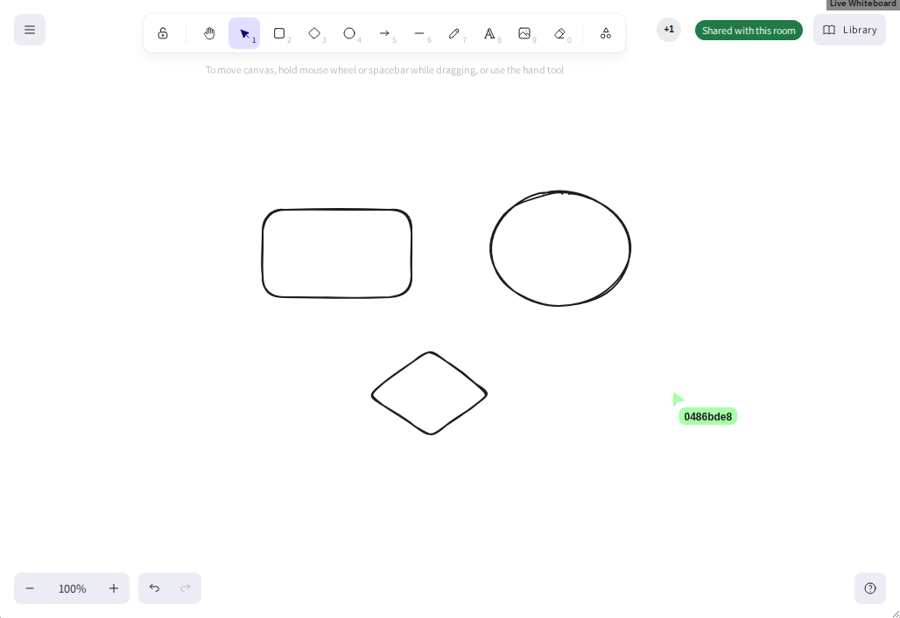

# Edrys Whiteboard Module

A whiteboard module for [Edrys-Lite](https://github.com/edrys-labs/edrys-Lite) classrooms, built on [Excalidraw](https://excalidraw.com). With `synchronize`, everyone in a room draws on one board in real time. Each room has its own board.



## Usage

Add this URL to your Edrys-Lite classroom:

```
https://edrys-labs.github.io/module-whiteboard/
```

The module is shown in every room (`show-in: *`). To draw together, tick **synchronize** in the module's settings (see below); without it, each person draws on a board of their own.

## Configuration

```json
{
  "synchronize": true
}
```

| Field | Type | Default | Description |
| --- | --- | --- | --- |
| `synchronize` | boolean | `false` | Share one board across all peers in the room, drawn on together in real time. Without it, each peer draws on their own board, which is not kept across a reload. |

The setting is read from the general `config` only, so everyone in the room either shares the board or nobody does. The settings form saves `false` for a checkbox you leave unticked: **drawing together needs `synchronize: true`**.

A badge in the top-right corner of the board says which mode is on: *Shared with this room* or *Only you see this board*.

## Role behavior

Teachers, students and stations all get the same board and the same tools. There are no role-specific settings.

## Where the drawings are kept

With `synchronize`, the board lives in the room's Edrys state and travels between the peers of the class like every other module's state. It is not sent to excalidraw.com or any other server. Peers who join later, or reload the page, get the board as it is. It lasts as long as the class's state does.

The module uses these keys in the room's state:

| Key | Holds |
| --- | --- |
| `whiteboard:element:<id>` | one element of the board (shape, line, text, …), as Excalidraw's JSON |
| `whiteboard:file:<id>` | one pasted image, as a data URL |

Every element is its own key, so peers drawing at the same time never overwrite each other's shapes. When two peers change the same element, the newer version wins, as in Excalidraw's own collaboration. Deleted elements stay in the state, marked as deleted.

Pointers, selections and names are shared through the awareness channel `whiteboard`.

Two whiteboard modules in the same room show the same board.

## Development

```bash
nvm use 24
npm install
npm run watch   # dev server on port 3002
npm run build   # production build → docs/ (includes Excalidraw's fonts)
```

`docs/` is not committed. Pushing to `main` builds it and deploys it to GitHub Pages (`.github/workflows/deploy.yml`); in the repository settings, the Pages source must be set to **GitHub Actions**.

The end-to-end tests are in `edrys-module-tests` (`modules/module-whiteboard`). Run `npm run build` here first: they load `docs/index.html`. They read the board through `window.excalidrawAPI`, which the module exposes for them.

## License

[MIT](LICENSE) © edrys-labs
